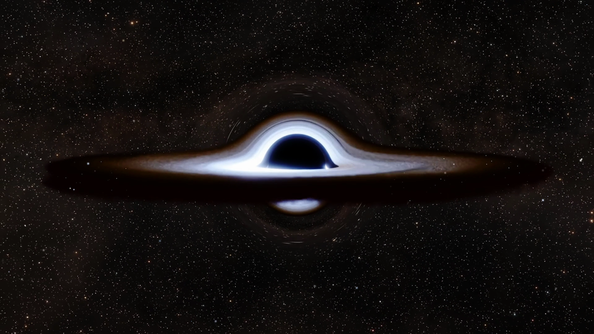

# Black Hole

A deep-space Omarchy theme: near-black blues, cool starlight text and a hot
orange accent borrowed from the glowing edge of a black hole.



## Install

```bash
omarchy theme install https://github.com/Joeykrod/omarchy-black-hole-theme.git
```

Omarchy clones the theme into `~/.config/omarchy/themes/black-hole` and
applies it right away. You can also use **Install → Style → Theme** from the
Omarchy menu and paste the repository URL.

## What's inside

| File | Purpose |
| --- | --- |
| `colors.toml` | The palette used by every themed app |
| `backgrounds/1-black-hole.mp4` | 1920×1080, 30 fps looping wallpaper |
| `preview.png` | Screenshot shown in the theme picker |
| `icons.theme` | Icon set paired with the theme |

## Palette

| Role | Colour |
| --- | --- |
| Background | `#05060a` |
| Foreground | `#d7dae6` |
| Accent | `#ff8a3d` |
| Red | `#ff4d6d` |
| Yellow | `#ffd166` |
| Green | `#7ee787` |
| Cyan | `#5ce1e6` |
| Blue | `#6ea8fe` |
| Magenta | `#c77dff` |

## Credits

- Palette and theme files: made for Omarchy.
- Black hole wallpaper: built from NASA's public-domain visualisations, then
  looped, colour-graded and composited for this theme. See [CREDITS.md](CREDITS.md)
  for the sources.
- Screenshot: a real Omarchy session running Neovim and fastfetch.

## License

The theme files (palette, configs, screenshot) are released under the MIT
License; see [LICENSE](LICENSE).

The background video is a derivative of NASA public-domain imagery and is
released under [CC0 1.0](https://creativecommons.org/publicdomain/zero/1.0/).
See [CREDITS.md](CREDITS.md) for the attribution.
